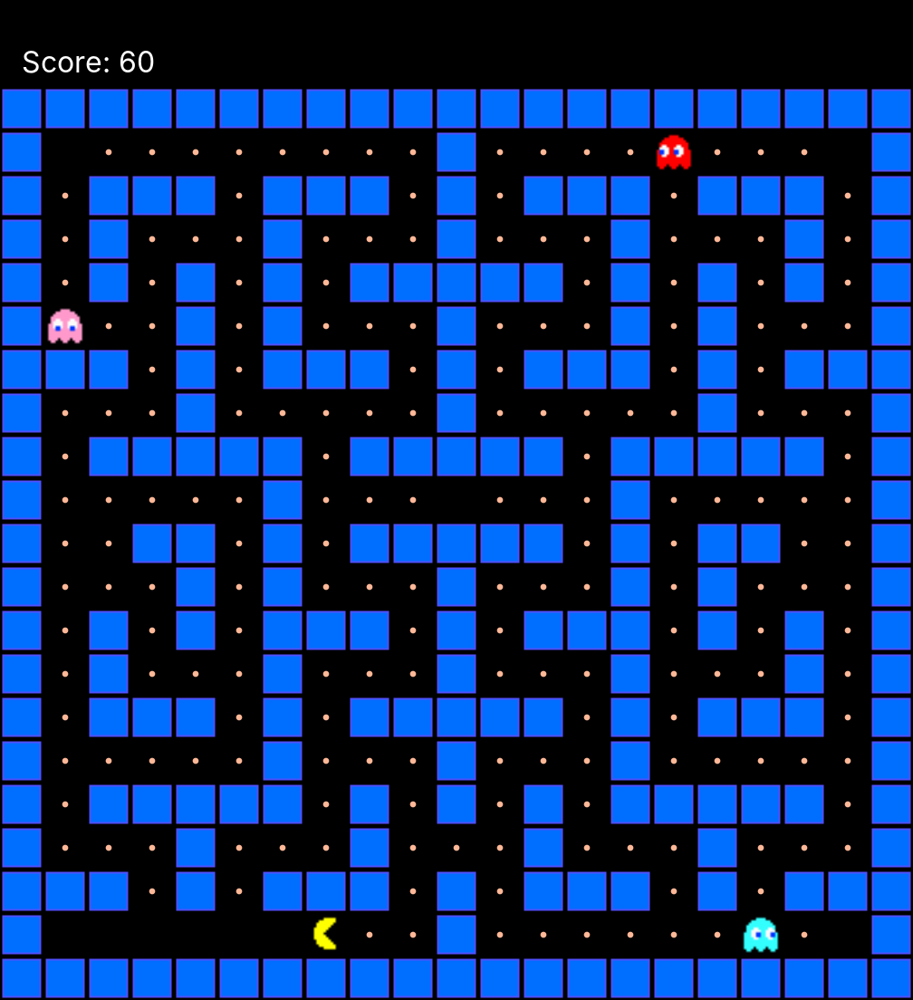

# Pac-Man in Java

CMPE 160 Object Oriented Programming course project, Spring 2026. A grid-based Pac-Man clone drawn with Princeton's StdDraw library: the player clears a maze of 209 pellets while three ghosts with different targeting strategies chase them.



## Controls

| Key | Action |
| --- | --- |
| Space | Start the game |
| Arrow keys | Move |
| P | Pause and resume |
| R | Restart after winning or losing |
| Q | Quit |

## Ghosts

| Ghost | Target |
| --- | --- |
| Pinky | Pac-Man's current tile |
| Inky | Pac-Man's tile 60% of the time, otherwise a random neighbouring tile |
| Blinky | The map corner closest to Pac-Man, by Manhattan distance |

Each ghost moves one tile at a time along a breadth-first-search shortest path to its target.

## How it works

- **State machine.** `Game` has six states: start screen, ready (1 second), playing, paused, won and lost. R returns to the start screen from either end state.
- **Grid position and screen position.** Game logic runs on the grid: a character chooses its next tile only when it is aligned with a cell. Each character also has a floating-point screen position that slides toward its grid tile every frame, which makes movement smooth. Collisions use the screen positions: Pac-Man is caught when a ghost's centre comes within half a tile of his.
- **Pathfinding.** `BFSPathFinder` runs breadth-first search over the maze and rebuilds the path from parent pointers. It uses `Queue<T>`, a generic queue on a circular array that doubles its capacity when full.
- **Map file.** `data/map.txt` holds the maze size, the start positions, the corner tiles Blinky can target and the layout (`#` wall, `.` pellet, `_` empty floor). Each pellet is worth 10 points.

## Files

| File | Role |
| --- | --- |
| `Main.java` | Loads the map, creates the objects, runs the game loop and reads the keyboard |
| `Game.java` | Game state, movement, pellets, collisions, win and loss, reset |
| `Player.java` | Pac-Man's position, direction and score |
| `Enemy.java` | Abstract ghost that follows a BFS path toward `selectTarget()` |
| `Pinky.java`, `Inky.java`, `Blinky.java` | The three targeting strategies |
| `BFSPathFinder.java` | Breadth-first search shortest path |
| `Queue.java` | Generic circular-array queue used by the search |
| `GameRenderer.java`, `MapData.java`, `Position.java` | Course starter code (see Credits) |

## Running it

The game needs `StdDraw.java` from Princeton's standard libraries, which is not included here. It also needs Java 14 or newer. From this folder:

```
curl -o src/StdDraw.java https://introcs.cs.princeton.edu/stdlib/StdDraw.java
javac -d out src/*.java
java -cp out Main
```

Run it from this folder, because the game loads `assets/` and `data/` with relative paths.

## Credits

- `GameRenderer.java`, `MapData.java`, `Position.java`, the sprites in `assets/` and the map in `data/map.txt` were provided by the CMPE 160 course staff as starter material. The other classes in `src/` are the assignment solution.
- StdDraw is part of the standard libraries by Robert Sedgewick and Kevin Wayne, Princeton University.
- Pac-Man is a trademark of Bandai Namco Entertainment. This is a non-commercial course project.
